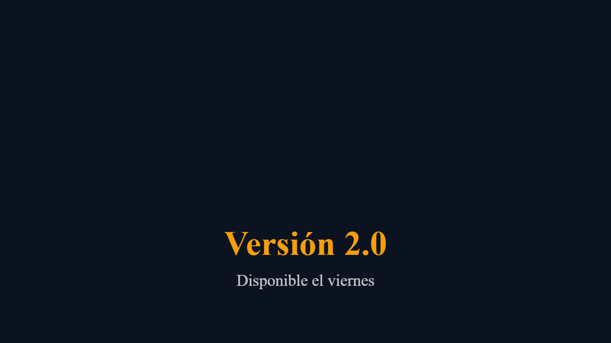
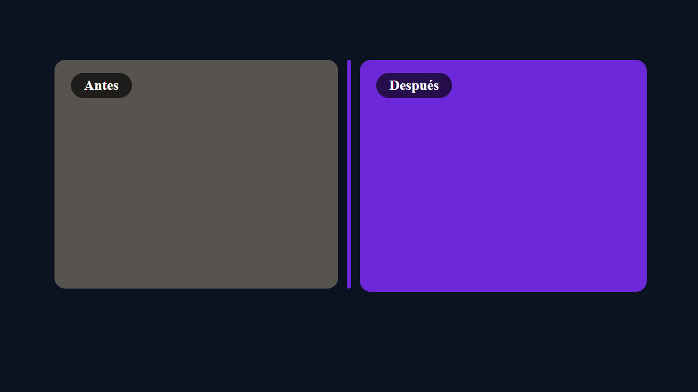
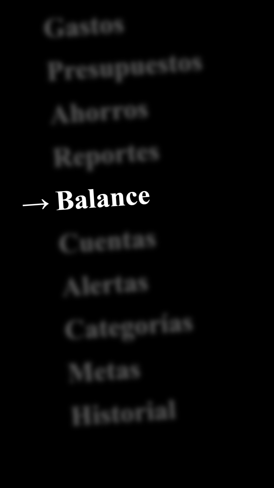

# Plantillas promocionales (Fase 3, MVP: 3)

Composiciones HyperFrames con variables (`data-composition-variables`):
el mismo `index.html` sirve a todas las marcas vía `--variables-file`
(y el panel Variables del Studio las edita en vivo).

| Plantilla            | Qué es                                                                                                                            |
| -------------------- | --------------------------------------------------------------------------------------------------------------------------------- |
| `promo-app/`         | App móvil: mockup con scroll, nombre, tagline, 3 features y CTA. 8 s.                          |
| `promo-web/`         | Web/SaaS: navegador con captura, titular, subtítulo, 3 features y CTA. 8 s.                    |
| `logo-sting/`        | Intro de logo (pop + reveal + tagline + fade). 6 s.                                          |
| `feature-highlight/` | Una función en 8 s: kicker, titular con reveal, subrayado y descripción.       |
| `stats/`             | 3 cifras con etiquetas en grilla. 6 s.                                                                 |
| `testimonios/`       | Cita con autor, cargo y estrellas. 6 s.                                                    |
| `oferta/`            | Badge, titular con descuento, descripción y CTA con pulse. 6 s.                                      |
| `precios/`           | 3 planes con destacado central y CTA. 6 s.                                                         |
| `evento/`            | Anuncio de evento en vivo con fecha y CTA. 6 s.                                                      |
| `lanzamiento/`       | Countdown 3-2-1 con reveal del nombre y fecha. 6 s.                                        |
| `antes-despues/`     | Comparativa con dos imágenes, divisor y etiquetas. 6 s.                                |
| `historia/`          | Vertical 9:16 con barra de progreso, titular y CTA. 6 s.                                         |
| `lista-cinetica/`    | Columna cinética vertical con foco nítido y flecha (estilo Jitter List). 9 s, 9:16.  |

## Multiformato (16:9, 9:16, 1:1, 4:5)

Todas salvo `historia` y `lista-cinetica` (nativas 9:16) traen composición
propia para cada formato: en su CSS, bloques `#stage[data-format="9:16"] …`
y en `template.json` la lista `formats`. No es un 16:9 encogido: cada
formato recoloca y reescala texto, mockups y CTA.

```bash
node instantiate.mjs --template promo-app --brand b.json --format 9:16 --out ./vertical
node ../render/render-batch.mjs --project ./mi-promo --dest all   # cada destino en su formato
```

`formats.mjs` (`applyFormat`) fija tamaño y `data-format`; el render por
lotes genera `.format-9x16.html` desde el `index.html` actual (lo editado en
el Studio llega a todos los formatos). `formats.test.mjs` comprueba que lo
declarado en `template.json` y los bloques CSS coinciden. Para añadir un
formato a una plantilla: bloque CSS + entrada en `formats`.

## Convención de variables

Las plantillas declaran `brand*` (colores, fuentes, logo, nombre, tagline)
más su contenido (`headline`, `feature1…`, `ctaLabel`, `screenShot`…).
`instantiate.mjs` fusiona: el contenido manda, la marca rellena lo que la
plantilla declara (lo no declarado se ignora, lo desconocido es error).

```bash
node instantiate.mjs --template promo-app \
  --brand ../brand-kit/brand.example.json \
  --vars vars.json --out ./mi-promo
node packages/cli/dist/cli.js render ./mi-promo --variables-file ./mi-promo/variables.json
```

`vars.json` ejemplo: `{"brandName":"Acme","ctaLabel":"Instalar ya"}`.

## Nota de build (galería del Studio)

El Home del Studio incrusta las plantillas vía
`packages/studio/src/home/wissmotionTemplates.ts`, pero tsup no entiende
`?raw`: el HTML viaja en `wissmotionTemplates.generated.ts`. Tras editar
cualquier `templates/<id>/index.html`:

```bash
node wissmotion/sync-templates.mjs
```

El test de frescura falla si lo olvidas.

## Guardar un proyecto como plantilla

```bash
node templateize.mjs --project ./mi-promo --id mi-promo --name "Mi promo"
```

Copia el `index.html` a `templates/<id>/` con `template.json` (formato
detectado del `data-width/height`) si declara variables; ida y vuelta
probada (la guardada se vuelve a instanciar).

## Regla de timing

El render dura lo que la **timeline**, no los clips: cada plantilla termina
su último tween (hold, pulse o fade de salida) exactamente en la duración
del manifiesto. `templates.test.mjs` lo verifica (±0.6 s).
