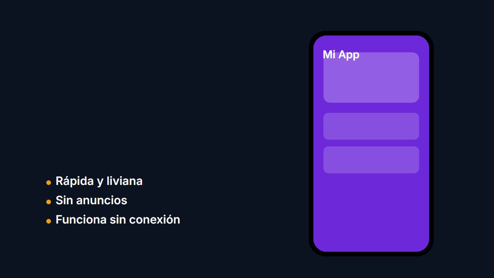
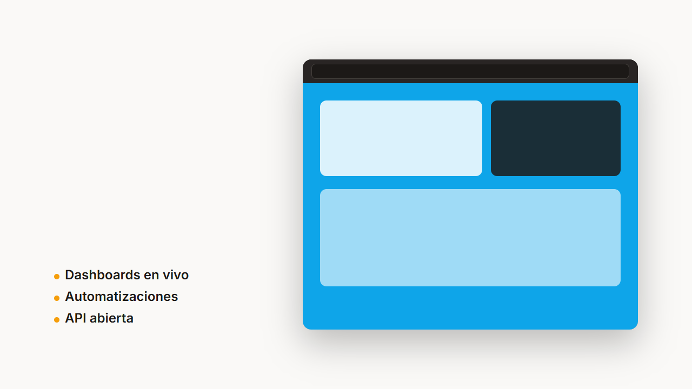
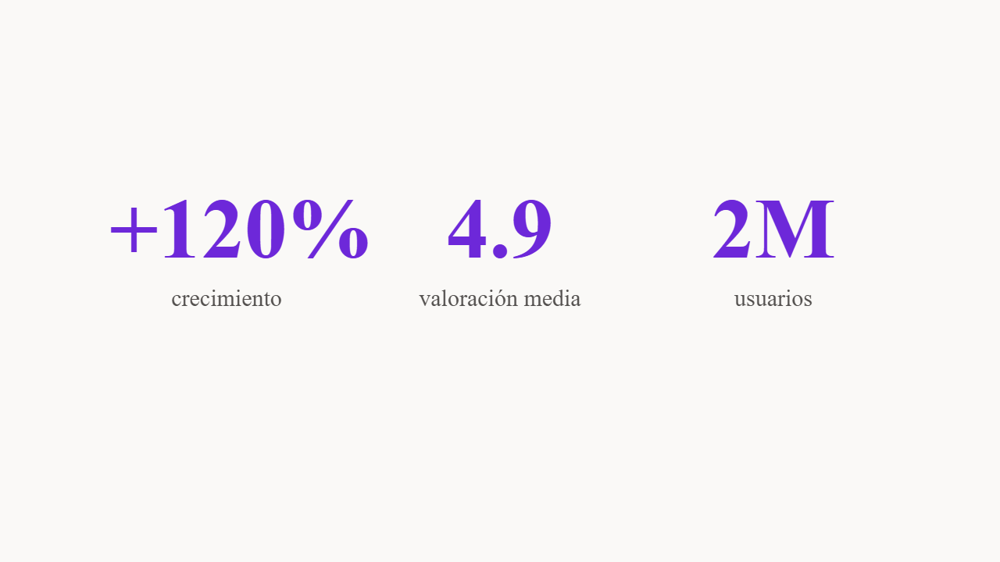
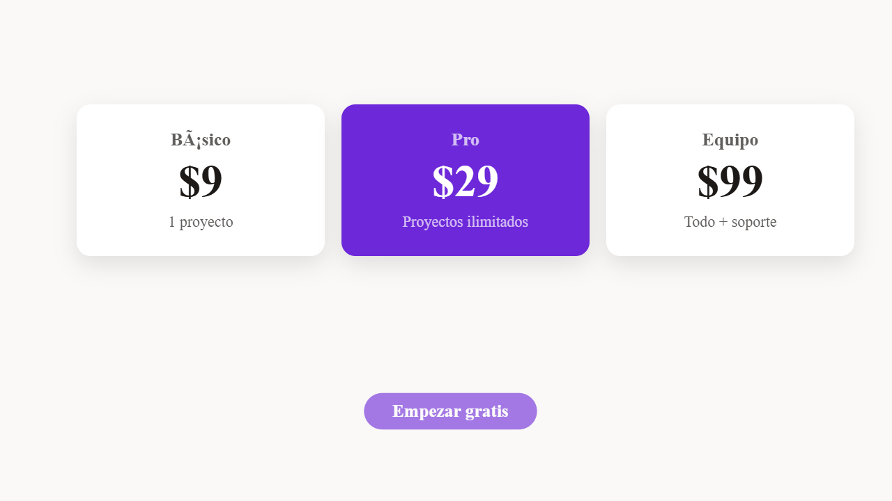

# Plantillas promocionales (Fase 3, MVP: 3)

Composiciones HyperFrames con variables (`data-composition-variables`):
el mismo `index.html` sirve a todas las marcas vía `--variables-file`
(y el panel Variables del Studio las edita en vivo).

| Plantilla            | Qué es                                                                                                                       |
| -------------------- | ---------------------------------------------------------------------------------------------------------------------------- |
| `promo-app/`         | App móvil: mockup con scroll, nombre, tagline, 3 features y CTA. 8 s.                     |
| `promo-web/`         | Web/SaaS: navegador con captura, titular, subtítulo, 3 features y CTA. 8 s.               |
| `logo-sting/`        | Intro de logo (pop + reveal + tagline + fade). 6 s.                                     |
| `feature-highlight/` | Una función en 8 s: kicker, titular con reveal, subrayado y descripción.  |
| `stats/`             | 3 cifras con etiquetas en grilla. 6 s.                                                            |
| `testimonios/`       | Cita con autor, cargo y estrellas. 6 s.                                               |
| `oferta/`            | Badge, titular con descuento, descripción y CTA con pulse. 6 s.                                 |
| `precios/`           | 3 planes con destacado central y CTA. 6 s.                                                    |
| `evento/`            | Anuncio de evento en vivo con fecha y CTA. 6 s.                                                 |

## Convención de variables

Las plantillas declaran `brand*` (colores, fuentes, logo, nombre, tagline)
más su contenido (`headline`, `feature1…`, `ctaLabel`, `screenShot`…).
`instantiate.mjs` fusiona: el contenido manda, la marca rellena lo que la
plantilla declara (lo no declarado se ignora, lo desconocido es error).

```bash
node instantiate.mjs --template promo-app \
  --brand ../brand-kit/brand.example.json \
  --vars vars.json --out ./mi-promo
node packages/cli/dist/cli.js render ./mi-promo --variables-file ./mi-promo/variables.json
```

`vars.json` ejemplo: `{"brandName":"Acme","ctaLabel":"Instalar ya"}`.
